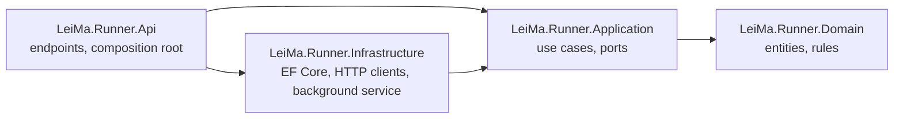
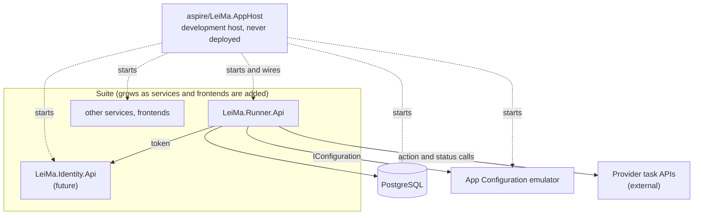
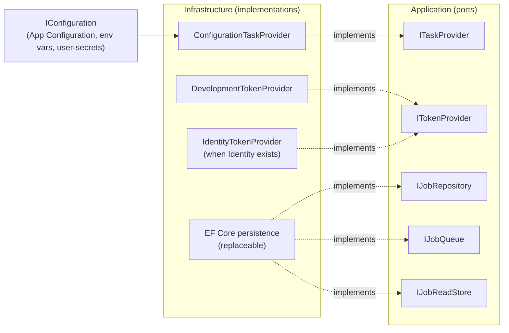

# 0003. Structure LeiMa.Runner with clean architecture, a shared Aspire AppHost and cloud-agnostic ports

- Status: proposed
- Date: 2026-11-14
- Deciders: project maintainers
- Related: issues #33, #34, [0002](0002-shared-leima-common-package.md)

## Context and problem statement
LeiMa.Runner is the first service of the suite. It runs long-running jobs made of ordered tasks against provider APIs and keeps their state in PostgreSQL. Its structure sets the pattern for later services, so three questions need an answer now: how the code is layered, how the suite is run locally (it will grow to many services and frontends), and how the service stays portable across clouds. Configuration is expected to use Azure App Configuration later, but nothing is deployed to Azure yet and the solution must not depend on one cloud.

## Decision drivers
- Business rules testable without ASP.NET Core, EF Core or HTTP
- One command starts the whole suite locally with dashboard, logs and traces
- Services stay independent: no shared domain code, no service referencing another
- No cloud-specific code in the domain or application logic; a different cloud means a different implementation, not a rewrite
- The ORM (EF Core today) can be replaced without changing domain or application logic
- Reuse of the `LeiMa.Common*` packages instead of re-implementing plumbing
- Low overhead for a small team

## Considered options
### Code structure
1. Clean architecture with four projects per service: Api, Application, Domain, Infrastructure
2. A single project with folders
3. Vertical slices in one project

### Local orchestration
4. One shared Aspire AppHost for the whole suite
5. One AppHost per service
6. Aspire plus a shared ServiceDefaults project
7. Docker Compose, no Aspire

### Cloud independence
8. Ports (interfaces) owned by Application, implementations in Infrastructure, configuration through `IConfiguration`
9. Use the Azure SDKs directly where needed

## Decision outcome
Chosen options: **1, 4 and 8**, because they keep the logic testable and portable while giving one place to run and observe the whole suite.

### Service layout (option 1)
```
services/LeiMa.Runner/
  LeiMa.Runner.slnx
  CLAUDE.md
  src/LeiMa.Runner.Domain/          entities, value objects, rules; no dependencies
  src/LeiMa.Runner.Application/     use cases, ports (interfaces), DTO mapping; depends on Domain
  src/LeiMa.Runner.Infrastructure/  EF Core, HTTP clients, port implementations; depends on Application
  src/LeiMa.Runner.Api/             endpoints, authentication, composition root; depends on Application and Infrastructure
  tests/LeiMa.Runner.UnitTests/  tests/LeiMa.Runner.IntegrationTests/  tests/LeiMa.Runner.ArchitectureTests/
```

- Dependencies point inward only; an architecture test fails the build on a violation.
- The Api is the only project that references Infrastructure, to register it.
- The background service that runs jobs lives in Infrastructure and is registered by the Api; the logic it calls lives in Application.
- Folder name follows the project names (`services/LeiMa.Runner`); later services follow the same pattern.

### Aspire (option 4)
- One AppHost for the whole suite in `aspire/LeiMa.AppHost`, with its own solution. It is a development and orchestration host, not a service, and is never deployed by us.
- It declares PostgreSQL, the App Configuration emulator and each service, and injects connection strings, service URLs and the OTLP endpoint (`OTEL_EXPORTER_OTLP_ENDPOINT`). New services and frontends are added to it as they appear.
- No ServiceDefaults project (option 6 rejected): `LeiMa.Common.AspNetCore` already provides logging, telemetry, health and ProblemDetails, and a ServiceDefaults project would duplicate it and put shared code into every service.
- The AppHost references service projects. This coupling is acceptable because only the development host knows all services; services never reference each other or the AppHost.

- Services must run without Aspire too (plain `dotnet run` with configuration from environment variables), so Aspire stays optional for them.

### Cloud-agnostic ports (option 8)
- **Configuration** goes through `IConfiguration` only. Azure App Configuration is one configuration provider, registered by the Api based on configuration. Locally it is the App Configuration emulator started by the AppHost. Nothing is pushed to Azure for now. Secrets never go into App Configuration; they come from environment variables, user-secrets or a secret store.
- **`ITaskProvider`** (Application port): resolves a task type to its action endpoint, status endpoint, authentication scheme and default timeout. First implementation in Infrastructure reads configuration.
- **`ITokenProvider`** (Application port): returns a valid bearer token for calling task endpoints, refreshed before expiry. The real implementation authenticates to LeiMa.Identity.Api; until that exists, a development implementation supplies a configured token.

- **Persistence ports** so the ORM can be replaced without touching Domain or Application. The database stays PostgreSQL; only the data-access technology is swappable:
  - `IJobRepository`: loads and saves the job aggregate (job with its tasks) and commits each use case atomically.
  - `IJobQueue`: claims queued jobs, extends and releases leases. Hides the PostgreSQL claiming technique (`FOR UPDATE SKIP LOCKED`, decided in the execution model ADR).
  - `IJobReadStore`: list and paging queries returning read models, so no `IQueryable` or ORM type crosses the boundary.
  - Domain entities are persistence-ignorant: no ORM attributes or base classes. Mapping is configured in Infrastructure (EF Core fluent configuration, with `LeiMa.Common.EntityFrameworkCore` conventions such as UTC timestamps and the `xmin` concurrency token, which are shadow properties and stay invisible to the domain). A different ORM maps the same entities.
  - Repositories are per aggregate, not generic. No ORM type (`DbContext`, `DbSet`, `IQueryable`) appears in Application or Domain; the architecture test checks the references.
- Domain and Application reference no Azure or other cloud SDK. A cloud-specific feature is added as a port with its own implementation in Infrastructure.

### Keep it light
The layers and ports are the structure; the following are deliberately not used, to keep the ceremony low:
- No mediator library or CQRS framework: a use case is a plain class injected into the endpoint.
- No generic repository and no separate persistence model: the ORM maps the domain entities directly.
- No pass-through code: an endpoint calls the use case; a use case that only forwards one call is a sign the layer is not needed there.
- DTOs only at the API boundary (requests and responses) and read models for queries; the domain is not exposed.
- Ports exist only where a second implementation is plausible (cloud, ORM, identity) or where they hide a technique that must be testable.
- One architecture test for the dependency rules, not a suite.

### Consequences
- Good: domain and application logic are unit-testable without infrastructure.
- Good: the ORM can be replaced by writing a new Infrastructure implementation of the persistence ports.
- Good: one command (`dotnet run` on the AppHost) starts everything with dashboard, logs and traces.
- Good: moving to another cloud means new implementations of the ports and a different configuration provider.
- Bad: four projects and persistence ports are more ceremony than a small service needs, which the "keep it light" rules limit.
- Bad: the persistence ports shape the queries and aggregates; a feature that needs a rich query adds a read-store method instead of using the ORM directly.
- Bad: the AppHost has to be kept in step with services (a project reference per service, wired in CI).
- Bad: Aspire is a further dependency to keep current.
- Follow-ups: scaffold the service and AppHost (Story 1, #36), CI and Dependabot for services, repo map and root `CLAUDE.md` updates, the `dotnet-backend` skill if the layout is refined, and the execution model ADR (#35).

## Pros and cons of the options
### 1. Clean architecture, four projects (chosen)
- Good: enforced boundaries, testable core, familiar to .NET developers.
- Bad: more projects and mapping code.

### 2. Single project with folders
- Good: least ceremony.
- Bad: boundaries are by convention only and erode.

### 3. Vertical slices in one project
- Good: features are cohesive and cheap to add.
- Bad: no enforced separation of domain from infrastructure; conflicts with the layering already in the `dotnet-backend` skill.

### 4. One shared AppHost (chosen)
- Good: the whole suite runs together, one dashboard.
- Bad: knows every service project.

### 5. AppHost per service
- Good: no cross-service knowledge.
- Bad: services cannot be run together; duplicated infrastructure resources.

### 6. Aspire plus ServiceDefaults
- Good: the standard Aspire template.
- Bad: duplicates `LeiMa.Common.AspNetCore` and shares code into every service.

### 7. Docker Compose
- Good: no new dependency, closer to many deployment targets.
- Bad: no dashboard or service discovery, more manual wiring, less .NET integration.

### 8. Ports and `IConfiguration` (chosen)
- Good: a different cloud is a different implementation.
- Bad: interfaces to maintain even where only one implementation exists.

### 9. Azure SDKs directly
- Good: fewer abstractions.
- Bad: cloud lock-in spread through the code.
