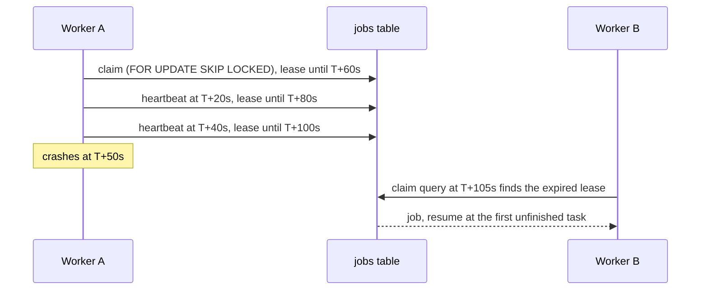
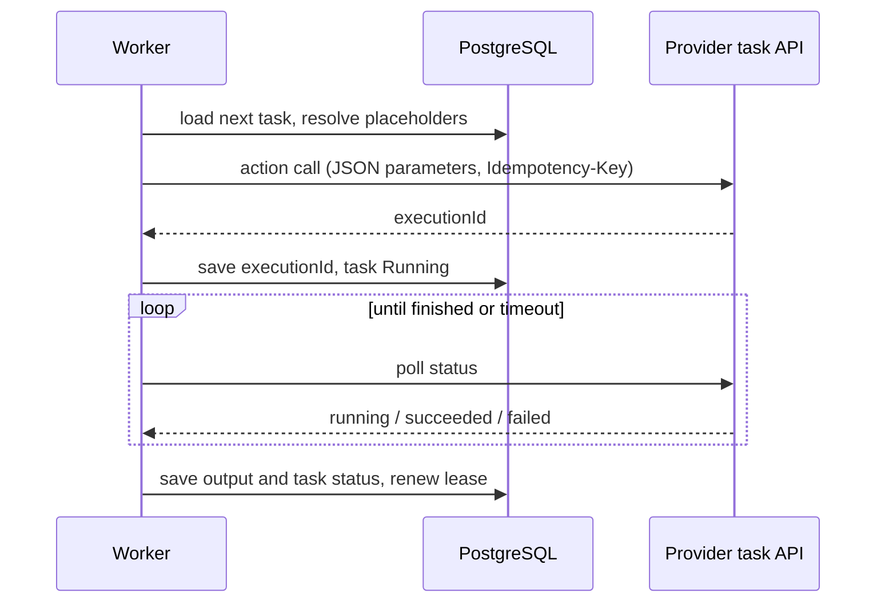
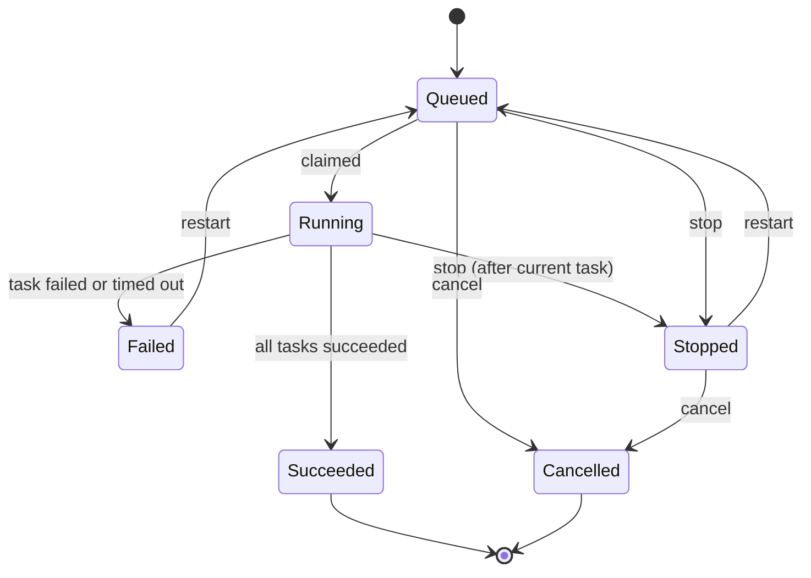

# 0004. Run jobs from a PostgreSQL queue with leases, sequential tasks and placeholder parameters

- Status: proposed
- Date: 2026-11-17
- Deciders: project maintainers
- Related: issues #33, #35, [0003](0003-runner-service-architecture.md)

## Context and problem statement
LeiMa.Runner executes jobs. A job is an ordered list of tasks; a task is a call to an external API: an action endpoint starts it and a status endpoint is polled until it finishes. Tasks can take a long time, may fail, and may use the output of an earlier task in the same job. Jobs are queued, run concurrently up to a configurable limit, and must resume after the service restarts. Users can stop, cancel and restart jobs. The model must define how jobs are queued and claimed, what happens on restart, how tasks are executed, timed out and retried, which statuses exist, and how parameters refer to earlier outputs.

## Decision drivers
- Jobs and tasks survive restarts and crashes; no work is lost or silently dropped
- No message broker for now (the broker decision is still open); portable across clouds, per [ADR 0003](0003-runner-service-architecture.md)
- Tasks run in strict order within a job; jobs run concurrently
- Calls to providers need timeouts, retries with backoff and rate-limit awareness
- Simple to reason about and test: state transitions live in the domain
- Several Runner instances should be able to run side by side without double-running a job

## Considered options
### Queue and execution
1. PostgreSQL as the queue: job rows with a status, claimed with a lease
2. In-memory queue with state in the database and a recovery scan on startup
3. A message broker (RabbitMQ, Azure Service Bus, ...)
4. A job library (Hangfire, Quartz.NET) or a workflow engine (Temporal)

### Parameter references
5. Placeholder strings such as `{{tasks.2.output.id}}` resolved just before a task runs
6. Structured reference objects (`{"$ref": ...}`)

## Decision outcome
Chosen options: **1 and 5**, because they meet the persistence and resume requirements with no new infrastructure, keep the domain model in our hands and stay portable.

### Queue, claiming and concurrency
- Jobs are rows in the Runner database. Creating a job stores it as `Queued`; there is no separate queue structure.
- A background service in Infrastructure runs a claim loop. While it has free capacity (`Runner:MaxConcurrentJobs`, default 4), it asks `IJobQueue` (see ADR 0003) to claim the oldest queued job. The PostgreSQL implementation claims in one statement with `FOR UPDATE SKIP LOCKED`, sets the job to `Running` and stamps a **lease** (owner and expiry), so two instances never get the same job. When the queue is empty it waits (configurable poll interval) and tries again.
- The concurrency limit applies per Runner instance. A global limit across instances is a follow-up if several instances are ever run.
- Within a job, tasks run one after another in position order. The job runs on one worker for its whole life.

### Lease, heartbeat and resume
- A **lease** is a time-limited claim stored on the job row: `status = Running`, `lease_owner` (the worker instance) and `lease_expires_at`. Claiming sets it to now plus the lease duration, in the same statement that selects the job.
- While a job runs, its worker renews the lease on a heartbeat (lease duration `Runner:LeaseSeconds`, default 60; renewed at a third of it, so one slow or missed renewal does not lose the job). The renewal is `UPDATE ... SET lease_expires_at = now + lease WHERE id = ? AND lease_owner = me`.
- **Lost lease**: if that update affects no row, the lease expired and another worker may own the job. The worker stops immediately and writes nothing further for the job (no task results, no status changes). This check is what prevents two workers advancing one job.
- A shorter lease recovers faster after a crash but writes more and risks false expiry on a slow moment; a longer lease does the opposite.
- On graceful shutdown the worker stops polling, releases the lease and leaves the job `Running` with an expired lease. After a crash the lease simply expires.
- The claim query also takes `Running` jobs whose lease has expired, so interrupted jobs are picked up by any instance, including the same one after a restart. Resume continues from the first task that has not succeeded.
- A task that was `Running` and has a stored **`executionId`** (returned by the action call) is resumed by polling it again; the action is not called a second time. If no reference was stored yet (crash between sending and saving), the action is called again. Tasks must therefore be idempotent, and Runner sends a stable `Idempotency-Key` header (the task id) so providers can recognise a repeated start.

Example with a 60 second lease (heartbeat every 20 seconds) and a crash:



### Task execution
- Per task: resolve parameters, call the action endpoint with the JSON parameters, store the execution reference, then poll the status endpoint until the task reports `Succeeded` or `Failed`. On success the output JSON is stored on the task.
- `ITaskProvider` (ADR 0003) gives the action URL, status URL template, polling interval and default timeout per task type; `ITokenProvider` gives the bearer token.
- **One fixed task API contract**, owned by Runner and published in its documentation (never in a shared package). Every task API must follow it; a provider that does not needs an adapter in front of it.
  - **Action**: `POST` to the action URL. Body: the resolved task parameters (JSON). Headers: `Authorization: Bearer`, `Idempotency-Key` (the task id) and `X-Correlation-Id`. Success is `200` or `202` with `{ "executionId": "<string>" }`.
  - **Status**: `GET` on the status URL with `{executionId}` substituted. `200` with `{ "status": "Running" | "Succeeded" | "Failed", "output": <JSON, when Succeeded>, "error": { "code": "...", "message": "..." } <when Failed> }`. A `404` means the execution is unknown and fails the task with reason `ExecutionNotFound`.
- **Timeout**: each task has a timeout, an optional property of the task, otherwise the task type default. It covers the whole task (action plus polling). When it expires the task is `Failed` with reason `TimedOut`; timeouts are not retried.
- **Retries**: transient failures of a single call (network errors, HTTP 408, 429, 5xx) are retried with exponential backoff and jitter (default 3 attempts), using the standard .NET HTTP resilience handler. `Retry-After` on 429 and 503 is honoured. A task that reports `Failed`, a 4xx other than 408 and 429, and a parameter resolution error are permanent and not retried. When a task fails, the job becomes `Failed` and the remaining tasks stay `Pending`.
- Polling backs off from the task type's interval up to a maximum so long tasks do not hammer providers.



### Statuses and control
- **Job**: `Queued`, `Running`, `Stopped`, `Succeeded`, `Failed`, `Cancelled`. **Task**: `Pending`, `Running`, `Succeeded`, `Failed`, `Cancelled`. A soft-deleted job carries a deletion timestamp and is hidden from normal queries; a hard delete removes the rows. A job that is `Queued` or `Running` cannot be deleted.
- **Stop** applies to a `Queued` or `Running` job. A `Queued` job stops immediately. A `Running` job is never interrupted: its running task finishes first, then the job becomes `Stopped` before the next task starts.
- **Cancel** applies only to a job that is not running: a `Queued` (not started) or `Stopped` job. To cancel a running job, stop it first. The job and its unfinished tasks become `Cancelled`; this is terminal.
- **Restart** applies to `Stopped` and `Failed` jobs: tasks that succeeded and their outputs are kept, the failed (or next pending) task is reset to `Pending`, and the job is queued again. `Cancelled` and `Succeeded` jobs cannot be restarted.
- A stop of a running job is recorded as a request on the job and the worker sees it on its next heartbeat or poll; cancel and the other changes happen directly. State transitions are methods on the domain entities that reject illegal moves.



### Parameters and outputs
- Task parameters are a JSON value stored as `jsonb`. The domain holds them as a JSON value type, not a database type. Outputs are stored the same way, with a size limit (`Runner:MaxOutputBytes`).
- A string in the parameters can contain a placeholder `{{tasks.<n>.output.<path>}}`, where `<n>` is the 1-based position of an earlier task in the job and `<path>` is a dot and index path into its output (for example `{{tasks.2.output.items[0].id}}`).
- Field names in the path (such as `items`) are not defined by Runner; they are whatever the earlier task's API returned in its `output`. Example: task 2 finishes with this output:
  ```json
  { "items": [ { "id": "c-101", "name": "Acme" }, { "id": "c-102", "name": "Globex" } ], "total": 2 }
  ```
  and task 3 has the parameters `{ "customerId": "{{tasks.2.output.items[0].id}}", "count": "{{tasks.2.output.total}}", "note": "first of {{tasks.2.output.total}}" }`. The call for task 3 is sent as `{ "customerId": "c-101", "count": 2, "note": "first of 2" }`: `tasks.2.output` is task 2's output, `.items[0]` its first list element and `.id` that element's `id`.
- When the placeholder is the whole string value, the referenced JSON value (number, object, ...) replaces it with its type kept; inside a longer string the value is inserted as text. A literal `{{` is written `\{{`.
- **At creation** the job is validated: placeholder syntax, and that `<n>` refers to an earlier position in the same job (a forward or self reference is rejected). **At run time**, just before the task starts, placeholders are resolved from the stored outputs; a missing path fails the task with reason `ParameterResolutionFailed` (not retried). The stored parameters keep the placeholders; the resolved values are used for the call and are not persisted.
- A succeeded task's output never changes, so a resumed or restarted job resolves the same values.

### Consequences
- Good: no new infrastructure; state, queue and history are in one database and visible with SQL.
- Good: restart-safe by construction; instances can be added without coordination.
- Good: transitions and parameter rules are pure domain logic and unit-testable; only claiming and polling need integration tests.
- Bad: polling the database for work adds latency (the poll interval) and a little load; `LISTEN/NOTIFY` can reduce it later.
- Bad: at-least-once start of a task after a crash; providers must honour idempotency.
- Bad: the concurrency limit is per instance; a running job cannot be interrupted, only stopped after its current task, so a long task delays a stop.
- Bad: every task API must follow the fixed contract; providers that do not need an adapter.
- Bad: the claiming technique is PostgreSQL specific; it is isolated in the `IJobQueue` implementation (ADR 0003).
- Follow-ups: persistence story with the job, task and lease columns; the execution, placeholder, runner and resume stories; global concurrency limit if needed; publish the task API contract (for example as an OpenAPI document) with the Runner; the message broker decision stays separate.

## Pros and cons of the options
### 1. PostgreSQL as the queue (chosen)
- Good: one store for state and queue, survives restarts, no extra infrastructure, portable.
- Bad: polling latency; we own the claiming, lease and heartbeat logic.

### 2. In-memory queue with a recovery scan
- Good: simple at runtime.
- Bad: queued work depends on a scan after every restart; two instances need extra coordination.

### 3. Message broker
- Good: push delivery, mature delivery guarantees.
- Bad: new infrastructure and a cloud decision before the first service exists; resume of long jobs still needs persisted state.

### 4. Job library or workflow engine
- Good: ready-made scheduling, retries and persistence.
- Bad: its job model and storage do not match jobs made of ordered tasks with output references and our status API; a heavy dependency or extra server for the core of the product.

### 5. Placeholder strings (chosen)
- Good: readable in JSON, easy to write by hand, resolved late so outputs are current.
- Bad: a small parser to build and test; escaping rules.

### 6. Structured reference objects
- Good: no string parsing.
- Bad: noisier, cannot be embedded in a string.
