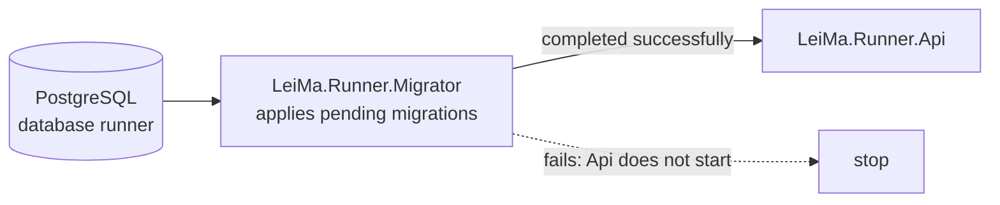

# 0005. Apply Runner database migrations with a separate migrator project

- Status: proposed
- Date: 2026-11-19
- Deciders: project maintainers
- Related: issues #33, #41, #73, [0003](0003-runner-service-architecture.md)

## Context and problem statement
The Runner stores jobs and tasks in its own PostgreSQL database and evolves the schema with EF Core migrations. Something has to apply them: before the Api starts locally through the AppHost, and later in any environment. The `entity-framework` skill says migrations go through a dedicated step and not on every request path. Several Api instances may run at once, and the cloud is not decided yet (ADR 0003), so the answer must not depend on one platform.

## Decision drivers
- Migrations are applied exactly once, safely, even when several instances start together
- The Api does not need rights to change the schema when it runs
- Local development stays one command: the AppHost starts everything in the right order
- The same step runs anywhere a one-shot process can run (no cloud-specific tooling)
- The migration code is testable against a real PostgreSQL database
- Small and clear for a small team

## Considered options
1. The Api applies migrations at startup
2. A separate `LeiMa.Runner.Migrator` console project that applies them and exits
3. Manual `dotnet ef database update` only
4. Generate an idempotent SQL script and let deployment tooling apply it

## Decision outcome
Chosen option: **2, a separate migrator project**, because it is a dedicated step that runs once per deployment, works on any platform that can run a process, and keeps schema rights away from the Api.

- **Project**: `services/LeiMa.Runner/src/LeiMa.Runner.Migrator`, a console application. It builds the database context from configuration, applies all pending migrations, logs what it did and exits with `0` on success and a non-zero code on failure. Running it again with nothing pending changes nothing.
- **Where the code lives**: the `DbContext`, the migrations and a small `MigrateAsync` method stay in Infrastructure. The migrator only calls it. The integration tests call the same method against PostgreSQL (`PostgreSqlFixture`), so they exercise the real code.
- **Dependencies**: the migrator is a second composition root next to the Api. It references Infrastructure (and through it Application) and nothing references it. Domain and Application keep the rules of ADR 0003: no ORM, web or cloud types. The architecture test is extended so the migrator may reference only Application and Infrastructure.
- **Relation to ADR 0003**: that ADR names four layer projects and says the Api is the only project referencing Infrastructure. The migrator is an additional host project, not a layer, and joins the Api in that rule as a composition root.
- **Local development**: the AppHost registers the migrator with a reference to the `runner` database, and the Api waits for its completion before it starts. A failed migration stops the Api from starting.
- **Other environments**: run the migrator as a one-shot process or job before rolling out the Api. Which mechanism that is will be decided with the deployment ADR.
- **Credentials**: in development both use the same connection string. Later, the migrator can get a database role with schema rights while the Api gets a role with data rights only.

### Consequences
- Good: one dedicated, repeatable step; the Api never changes the schema and can run with fewer rights.
- Good: the same migrator runs locally, in CI tests and in any future environment.
- Good: concurrent starts are safe: EF Core takes a database lock while applying migrations, and a second run finds nothing to do.
- Bad: one more project and one more resource in the AppHost to maintain.
- Bad: before the Api can start, the migrator must have finished, which adds a little to local startup time.
- Follow-ups: create the migrator and the first migration (#77), register it in the AppHost (#78), integration tests (#79), and decide how it is run outside the AppHost with the deployment ADR.

## Pros and cons of the options
### 1. The Api applies migrations at startup
- Good: nothing extra to run.
- Bad: every instance tries it; the Api needs schema rights; a failed migration happens inside the serving process; against the `entity-framework` skill.

### 2. Separate migrator project (chosen)
- Good: dedicated step, runs once, platform neutral, testable.
- Bad: another project and an ordering rule to keep.

### 3. Manual `dotnet ef database update`
- Good: simplest to start with.
- Bad: easy to forget, needs the SDK and source on the machine, not repeatable by tooling.

### 4. Idempotent SQL script applied by deployment tooling
- Good: reviewable SQL; works without .NET at deploy time.
- Bad: needs deployment tooling that does not exist yet; local development still needs another way to apply it.
