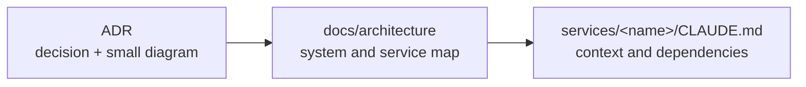

# Architecture

System overview and service map go here as services are added. Decisions are recorded in [../adr](../adr).

## Diagrams
Diagrams are [Mermaid](https://mermaid.js.org/) blocks in the Markdown files, rendered by GitHub. Keep each one small and about one idea, and update it in the same change as the code or decision. Which diagram type to use, where, and the rules are in the `documentation` skill (`.claude/skills/documentation/SKILL.md`).

## Glossary
See "Domain terms" in the root [CLAUDE.md](../../CLAUDE.md).
