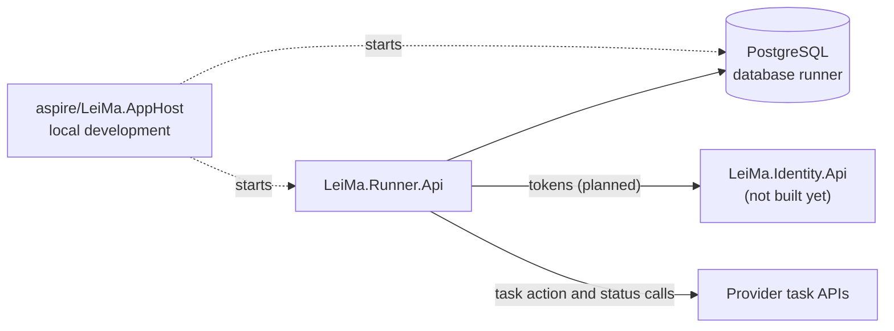

# LeiMa.Runner

Runs jobs made of ordered tasks against external provider APIs and keeps their state in PostgreSQL, so jobs survive restarts. Decisions: [ADR 0003](../../docs/adr/0003-runner-service-architecture.md) (architecture) and [ADR 0004](../../docs/adr/0004-runner-execution-model.md) (execution model). Tracking: feature #33.

**State:** skeleton only (Story #36). The layers, health endpoints and local setup exist; the job features are in the backlog (stories #41 to #54).

## Responsibilities
- Owns jobs and tasks: their definition, status, queue, execution and history.
- Owns the task API contract that providers must follow (action call plus status polling, ADR 0004).
- Does not own provider credentials or user identity: tokens come from LeiMa.Identity.Api (not built yet) through `ITokenProvider`.

## Public API / events
- Now: `/health/live` and `/health/ready` (anonymous). Unknown routes return a ProblemDetails response.
- Planned: create, read, update, delete (soft and hard), stop, cancel and restart for jobs. No events yet.

## Data
- PostgreSQL, database `runner` (one database per service). No tables yet.
- Planned: jobs, tasks (parameters and outputs as JSON, `run` and `executionId`), lease columns for the queue (ADR 0004).

## Dependencies

- `LeiMa.Common.AspNetCore` (logging, telemetry, ProblemDetails, correlation ids, health), from GitHub Packages through `services/nuget.config`.

## Project layout
```
LeiMa.Runner.slnx
src/LeiMa.Runner.Domain          entities and rules, no dependencies
src/LeiMa.Runner.Application     use cases and ports (interfaces), depends on Domain
src/LeiMa.Runner.Infrastructure  EF Core, HTTP clients, queue, background service; depends on Application
src/LeiMa.Runner.Api             endpoints and composition root; depends on Application and Infrastructure
tests/LeiMa.Runner.ArchitectureTests
```

## Run / test
```bash
# Everything locally (PostgreSQL, the Runner and the Aspire dashboard at http://localhost:15888); needs Docker
dotnet run --project aspire/LeiMa.AppHost

# Only the Api, without PostgreSQL
dotnet run --project services/LeiMa.Runner/src/LeiMa.Runner.Api

dotnet test services/LeiMa.Runner/LeiMa.Runner.slnx
```
Restoring needs `LEIMA_NUGET_OWNER` and `LEIMA_NUGET_TOKEN` (see [LeiMa.Common](../../libs/dotnet/LeiMa.Common/CLAUDE.md)). Problems with Docker, tokens or the AppHost are in the [FAQ](../../docs/FAQ.md).

## Conventions / gotchas
- Every code element, public or not, needs an XML documentation comment (`GenerateDocumentationFile` plus StyleCop rule SA1600 only, in `src`); the build fails without it.
- References point inward only. Domain and Application must not use an ORM, ASP.NET Core or a cloud SDK; the architecture tests enforce this. Persistence and cloud access go behind ports in Application (ADR 0003).
- Keep it light: no mediator library, no generic repositories, no separate persistence model (ADR 0003).
- A task start must be idempotent: the key sent to providers is `<taskId>:<run>` (ADR 0004).
- Stop never interrupts a running task; cancel only applies to jobs that are not running (ADR 0004).
