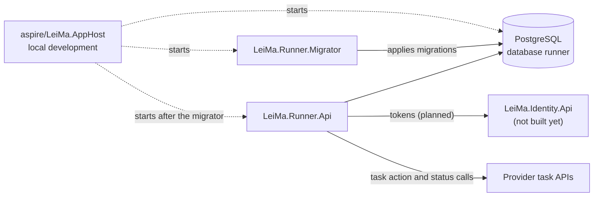

# LeiMa.Runner

Runs jobs made of ordered tasks against external provider APIs and keeps their state in PostgreSQL, so jobs survive restarts. Decisions: [ADR 0003](../../docs/adr/0003-runner-service-architecture.md) (architecture) and [ADR 0004](../../docs/adr/0004-runner-execution-model.md) (execution model). Tracking: feature #33.

**State:** skeleton plus persistence (Stories #36 and #41). The layers, health endpoints, local setup, job and task domain model, `IJobRepository` with its EF Core implementation, the migrator and the integration tests exist; the job features (API, queue, execution) are in the backlog (stories #42 to #54).

## Responsibilities
- Owns jobs and tasks: their definition, status, queue, execution and history.
- Owns the task API contract that providers must follow (action call plus status polling, ADR 0004).
- Does not own provider credentials or user identity: tokens come from LeiMa.Identity.Api (not built yet) through `ITokenProvider`.

## Public API / events
- Now: `/health/live` and `/health/ready` (anonymous). Unknown routes return a ProblemDetails response.
- Planned: create, read, update, delete (soft and hard), stop, cancel and restart for jobs. No events yet.

## Data
- PostgreSQL, database `runner` (one database per service), connection string name `runner`.
- Tables: `jobs` (name, description, status, soft-delete time) and `job_tasks` (job, `Position`, task type, `Parameters` and `Output` as `jsonb`, timeout, status, `Run`, `ExecutionId`, error code and message). Statuses are stored as text. Both tables have `CreatedAt` / `UpdatedAt` (UTC `timestamptz`, filled from `TimeProvider`) and the `xmin` concurrency token. `(JobId, Position)` is unique.
- Access goes through `IJobRepository` (Application, `Repository/` folder): `Add`, `GetAsync` (the job with its tasks ordered by `Position`, ordered explicitly in the query) and `SaveChangesAsync`, which returns the conflict error `job.concurrency_conflict` (HTTP 409) when someone else changed the job after it was loaded. The change tracker is the unit of work: one scope, one `SaveChangesAsync`.
- Schema changes: add an EF Core migration in `Infrastructure/Persistence/Migrations` and keep the model and migrations in step (a test fails otherwise). Migrations run in `LeiMa.Runner.Migrator` (ADR 0005), never in the Api. The AppHost starts the migrator first and the Api waits for it to finish.
- Planned: lease columns for the queue (ADR 0004).

## Dependencies

- `LeiMa.Common.AspNetCore` (logging, telemetry, ProblemDetails, correlation ids, health), `LeiMa.Common.EntityFrameworkCore` (UTC conventions, `xmin`, audit timestamps) and, in the integration tests, `LeiMa.Common.Testing`, all from GitHub Packages through `services/nuget.config`.

## Project layout
```
LeiMa.Runner.slnx
src/LeiMa.Runner.Domain          Job, JobTask and their rules (validated in Job.Create), no dependencies
src/LeiMa.Runner.Application     use cases and ports (interfaces such as Repository/IJobRepository), depends on Domain
src/LeiMa.Runner.Infrastructure  Persistence/ (DbContext, mapping, repository, Migrations/), HTTP clients, queue, background service; depends on Application
src/LeiMa.Runner.Api             endpoints and composition root; depends on Application and Infrastructure
src/LeiMa.Runner.Migrator        console app that applies the migrations; composition root, depends on Application and Infrastructure
tests/LeiMa.Runner.UnitTests         domain rules, no database
tests/LeiMa.Runner.IntegrationTests  repository and migrations against a real PostgreSQL container (needs Docker)
tests/LeiMa.Runner.ArchitectureTests layer dependencies
```

## Run / test
```bash
# Everything locally (PostgreSQL, the Runner and the Aspire dashboard at http://localhost:15888); needs Docker
dotnet run --project aspire/LeiMa.AppHost

# Only the Api, without PostgreSQL
dotnet run --project services/LeiMa.Runner/src/LeiMa.Runner.Api

dotnet test services/LeiMa.Runner/LeiMa.Runner.slnx

# Add a migration (the tool version is pinned in dotnet-tools.json; run `dotnet tool restore` once).
# The connection string only has to exist, nothing connects to it (see the FAQ)
ConnectionStrings__runner="Host=localhost;Database=design_time_only" dotnet ef migrations add <Name> --project services/LeiMa.Runner/src/LeiMa.Runner.Infrastructure --startup-project services/LeiMa.Runner/src/LeiMa.Runner.Migrator --output-dir Persistence/Migrations
```
The integration tests start a PostgreSQL container: locally they are skipped when Docker is not running, on CI they fail without it.
Restoring needs `LEIMA_NUGET_OWNER` and `LEIMA_NUGET_TOKEN` (see [LeiMa.Common](../../libs/dotnet/LeiMa.Common/CLAUDE.md)). Problems with Docker, tokens or the AppHost are in the [FAQ](../../docs/FAQ.md).

## Conventions / gotchas
- Every code element, public or not, needs an XML documentation comment (`GenerateDocumentationFile` plus StyleCop rule SA1600 only, in `src`); the build fails without it.
- References point inward only. Domain and Application must not use an ORM, ASP.NET Core or a cloud SDK; the architecture tests enforce this. Persistence and cloud access go behind ports in Application (ADR 0003).
- Keep it light: no mediator library, no generic repositories, no separate persistence model (ADR 0003).
- A task start must be idempotent: the key sent to providers is `<taskId>:<run>` (ADR 0004).
- Stop never interrupts a running task; cancel only applies to jobs that are not running (ADR 0004).
